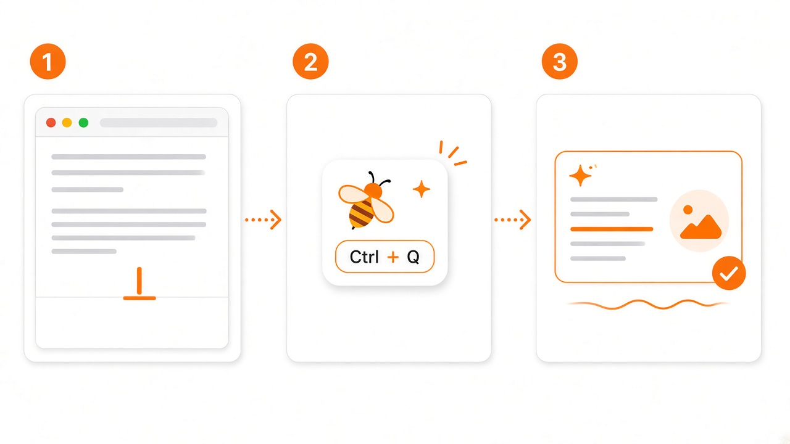

<p align="center">
  
</p>

<h1 align="center">Prompt Pad</h1>

<p align="center">
  <strong>Your always-on prompt studio for Windows.</strong><br />
  One hotkey. One floating bee. Private memory that compounds with every rewrite.
</p>

<p align="center">
  <a href="./README.md">中文</a> · <a href="./README.en.md">English</a>
</p>

<p align="center">
  <a href="#why-prompt-pad"></a>
  <a href="#architecture"></a>
  <a href="#memory-that-compounds"></a>
  <a href="#quick-start"></a>
</p>

---

## The pitch

If you write with AI every day, you already know the friction:

- Great prompts live in random chat tabs and die there.
- The same corrections get retyped every morning.
- Cloud “memory” products want your drafts, keys, and habits.

**Prompt Pad is the opposite bet.**

It is a **tiny always-on layer** for Windows: a bee-shaped DOT that stays above every app. Hit `Ctrl+Q`, drop in a rough prompt, get a sharper one back — and let a private memory loop quietly learn *how you like to ask*.

> **Dialogue is a draft. Files are the brain.**  
> The model does not “remember you.” It remembers *where to look*.

---

## Why Prompt Pad

| Advantage | What it means in practice |
|---|---|
| **Tiny when unused** | A ~64px floating DOT. No Electron tray bloat. No permanent docked window eating attention. |
| **Powerful when opened** | One-shot rewrite with provider-agnostic APIs (OpenAI-compatible / Anthropic Messages / Ollama / MiniMax). |
| **Memory that compounds** | Nightly distillation turns today’s PE records into reusable rules. Next rewrite injects only what earned its place. |
| **Retrieval that understands Chinese** | Stage-2 FTS5 `trigram` BM25 (+ short-query LIKE fallback). Domain route remains the safety net. |
| **Local-first by design** | SQLite + Markdown on disk. API keys stay on this machine. No cloud sync product. |
| **Focus-respecting UX** | Doesn’t steal your typing cursor when collapsed; returns focus to the previous app when you dismiss. |
| **Auditable memory** | `memory.md` is plain Markdown, git-friendly, and capped at **800 tokens** for injection. |

<p align="center">
  
</p>

---

## 60-second story

<p align="center">
  
</p>

1. **Draft anywhere** — VS Code, browser, Notion, email. Write the messy version.
2. **Invoke the bee** — `Ctrl+Q` (configurable). Paste or auto-prefill from clipboard.
3. **Ship the rewrite** — One click. Copy. Optionally rate 1–5 so memory weights update.

No new chat thread. No context window archaeology. Just a pad that appears, helps, and disappears.

---

## Memory that compounds

<p align="center">
  
</p>

| Layer | Carrier | Role |
|---|---|---|
| **L0 Temporary** | Session context | Discarded when the panel closes |
| **L1 Facts** | `memory/prompt_engineering.md` | Append-only PE records (`PE-YYYY-NNN`). Permanent. Immutable. |
| **L2 Memory** | `memory/memory.md` | Distilled rules ≤ **800 token** hard budget |
| **L3 Index** | SQLite + FTS5 | Rebuildable search index. Markdown is the source of truth. |

**Injection discipline** (the part most “AI memory” tools skip):

- Only `statement` + `why` + `how_to_apply` enter the model
- `candidate` never injects until proven
- No match → the model is told clearly: **「暂无历史经验」**
- Ratings: ≥4 → `+1` · flat → `0` · worse → `−2` (punish harder than you reward)

State machine:

```text
candidate  --(weight ≥ 2)-->  active  --(weight < −1 or 3 misses)-->  deprecated
```

---

## Product principles

1. **TINY WHEN UNUSED** — If it fights for attention, it fails.
2. **POWERFUL WHEN OPENED** — One panel. One primary action. Instant rewrite.
3. **DATA NEVER LEAVES THIS MACHINE** — Local Markdown + SQLite. Your git. Your rules.
4. **MARKDOWN IS THE BRAIN** — Indexes can burn; truth must survive rebuilds.
5. **MEMORY MUST EARN INJECTION** — Weight, status, and token budget are product features, not afterthoughts.

---

## Architecture

```text
┌──────────────────────────────────────────────────────────┐
│  React 18 · TypeScript · Tailwind · Zustand              │
│  Dot · Panel · Result · Settings · Status                │
└───────────────────────────┬──────────────────────────────┘
                            │ Tauri IPC (typed commands)
┌───────────────────────────▼──────────────────────────────┐
│  Rust · Tauri 2                                          │
│  commands/ → services/ → storage/                        │
│  window · provider · memory · nightly · tray · geometry  │
└───────────────────────────┬──────────────────────────────┘
                            │
        ┌───────────────────┴───────────────────┐
        ▼                                       ▼
 memory/*.md (truth)                    SQLite + FTS5 (index)
```

**Hard constraints we actually keep:**

- Shell: **Tauri 2** (not Electron)
- Plugins allowlist: global-shortcut · single-instance · autostart · clipboard-manager
- Tray via core `tauri::tray`
- Windows-first (Linux not in scope for this release)

---

## Feature map

| # | Capability | Status |
|---|---|---|
| ① | Transparent always-on-top frameless window | ✅ |
| ② | Persistent DOT (drag, % position per monitor) | ✅ |
| ③ | Expand / collapse with edge-aware placement | ✅ |
| ④ | One-click rewrite (OpenAI / Anthropic protocols) | ✅ |
| ⑤ | PE records → SQLite + Markdown | ✅ |
| ⑥ | Hotkey · tray · autostart · single instance | ✅ |
| ⑦ | Retrieval: domain fallback + **FTS5 trigram BM25** | ✅ |
| ⑧ | Nightly memory distillation | ✅ |
| ⑨ | Memory injection ≤800 tokens | ✅ |
| ⑩ | Rating → weight updates | ✅ |
| ⑪ | Cold-start penalty exemption (first 10) | ✅ |
| — | Vector / sqlite-vec stage-3 | 🔒 frozen until corpus grows |

---

## Quick start

### Prerequisites

- Windows 11
- Node.js 22+ · pnpm 12+
- Rust stable (MSVC). If the toolchain lives on D: drive, put `D:\Rust\cargo\bin` on `PATH`.

### Install & run

```bash
pnpm install
pnpm tauri dev      # full desktop app
```

Frontend-only UI loop:

```bash
pnpm dev            # http://localhost:1420
pnpm typecheck && pnpm test && pnpm lint
```

Quality gates:

```bash
pnpm check          # rust balance · geometry · sqlite DDL · docs JSON
cargo test  --manifest-path src-tauri/Cargo.toml
cargo clippy --manifest-path src-tauri/Cargo.toml --all-targets
```

### Connect a model

Open **Settings** from the tray or the panel gear. Presets include MiniMax, Anthropic, OpenAI-compatible, and Ollama.

Keys may live in:

1. Local plaintext field in `%APPDATA%` config (never committed), or
2. An environment variable name you configure

The backend **never echoes** the raw key back to the UI — only `api_key_present`.

---

## Repository layout

```text
PromptPad/
├── AGENTS.md                 # engineering baseline (read first)
├── README.md                 # Chinese (default)
├── README.en.md              # English
├── src/                      # React 18 UI
├── src-tauri/                # Rust backend
├── memory/                   # L1 + L2 Markdown brain (git-tracked)
├── docs/                     # spec · architecture · DB · API · assets
├── scripts/                  # zero-dep quality gates + icon generator
└── software_prompts/         # reference prompt templates (read-only)
```

Deep dives:

| Doc | What it answers |
|---|---|
| [`AGENTS.md`](AGENTS.md) | Non-negotiable constraints & current status |
| [`docs/spec.md`](docs/spec.md) | Product requirements & acceptance criteria |
| [`docs/architecture.md`](docs/architecture.md) | Layering & dependency rules |
| [`docs/database-design.md`](docs/database-design.md) | SQLite / FTS5 schema |
| [`docs/interface-doc.md`](docs/interface-doc.md) | Tauri command contracts |

---

## Who this is for

- Builders who rewrite prompts **dozens of times a day**
- People who want memory **without uploading a second brain to a vendor**
- Anyone allergic to Electron-resident “AI sidebars” that never get out of the way

If you only prompt once a week, a chat UI is enough.  
If prompting is part of your craft, Prompt Pad is infrastructure.

---

## Roadmap snapshot

- [x] Local rewrite pad with focus-safe floating UX  
- [x] Markdown-true memory + nightly distillation  
- [x] Stage-2 Chinese-capable FTS retrieval  
- [ ] Stage-3 local embeddings + sqlite-vec (gated on real corpus size)  
- [ ] Optional DPAPI-sealed API key storage  
- [ ] Richer onboarding / first-run guided setup  

---

## License & contribution

Personal / early product stage. Issues and thoughtful PRs welcome once the public surface stabilizes.

---

<p align="center">
  <em>Tiny when unused. Powerful when opened. Yours when remembered.</em><br />
  <strong>Prompt Pad</strong>
</p>
