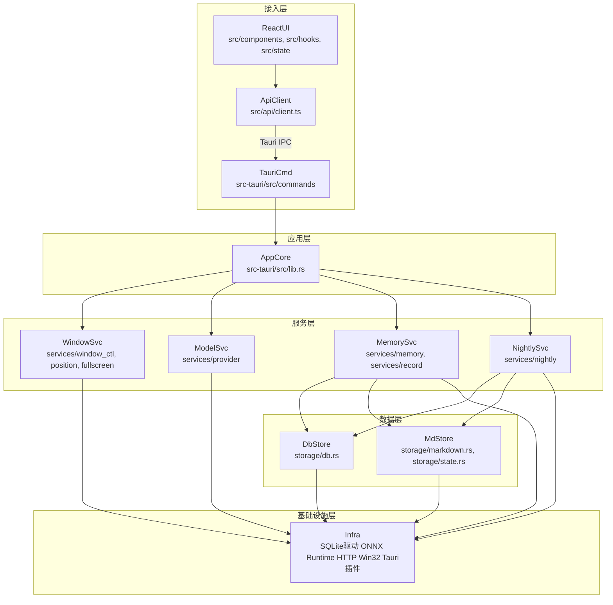

# Prompt Pad · 分层系统架构设计

> 依据：`AGENTS.md`（唯一事实基线）、`software_prompts/02-architecture.md` ARC-02、`docs/01-案例调研与技术选型.md`、`docs/02-私人记忆库设计.md`。
> 适用形态：Windows 单机单用户桌面应用（Tauri 2 + React 18 + Rust），**无网络服务端**，数据不出本机。
> 依赖规则（三条硬约束，全文贯穿）：
> 1. **自上而下**：接入层 → 应用层 → 服务层 → 数据层 → 基础设施层，禁止反向依赖。
> 2. **上层不得直连数据层**：任何持久化数据（SQLite 表、`memory/*.md`、本地状态文件）只能经数据层访问，接入层与应用层一律不得直接读写。
> 3. **基础设施层是共享底座**：它只承载无业务语义的运行时原语（配置 schema、错误类型、SQLite/FTS5/sqlite-vec 驱动、ONNX Runtime、HTTP 客户端、Win32 绑定、Tauri 插件与托盘），允许被上层直接引用；因此「服务层 → 基础设施层」属于**向下到底层**而非跨层取数，跨层禁令只针对第 2 条的数据访问路径。

---

## 1. 分层职责表

| 层级 | 职责边界 | 允许依赖 | 禁止依赖 |
|---|---|---|---|
| **接入层** `src/`（components / hooks / state / api） `src-tauri/src/commands/` | 呈现 DOT 与面板 UI、采集输入与交互事件；`src/api/client.ts` 是**唯一** invoke 出口（8 个 command 契约）；Rust 侧 `#[tauri::command]` 仅做参数反序列化与三类边界校验（空输入 / 类型错误 / 超量超长），把 `AppError` 归一化为可序列化错误回传。 | 应用层（经 Tauri IPC 调用 Rust 用例）；基础设施层的 `error.rs` / `config.rs`（仅类型与常量引用）。 | 服务层、数据层；禁止在组件内直接 `invoke`；禁止直连 SQLite、`memory/*.md`、模型 API、OS API。 |
| **应用层** `src-tauri/src/lib.rs` （用例编排 + 记忆策略） | 编排 8 个用例：`toggle_panel` / `optimize_prompt` / `save_pe_record` / `submit_feedback` / `retrieve_memories` / `run_nightly_job` / `get_config` / `set_config`；承载跨服务的业务策略：记忆状态机（`candidate → active → deprecated`）、权重规则（≥4 → +1、无改善 → 0、变差 → −2）、连续未命中计数、注入集裁剪（只留 `statement` + `why` + `how_to_apply`，按 `weight` 降序 Top-K，总量 ≤800 token）、RRF 归一化 0–1、检索阶段路由（<50 条纯 Markdown domain 路由 / 50–300 条 FTS5 BM25 / 300+ 条 sqlite-vec KNN+RRF）、托盘与插件装配。 | 服务层；基础设施层的 `config.rs` / `error.rs`。 | **数据层**（持久化一律经服务层转发）；基础设施层的 OS / ONNX / HTTP 驱动；禁止在命令层写业务分支，禁止跨层调用数据访问。 |
| **服务层** `src-tauri/src/services/` | 提供可复用的领域服务，每个服务只暴露用例级能力，不做用例编排：`window_ctl`（置顶 / 焦点 / 点击穿透 / 边缘展开方向 / 面板不出屏 / 全屏隐藏）、`position`（多显示器 + DPI 百分比坐标换算）、`fullscreen`（独占全屏探测）、`provider`（`minimax` / `openai_compat` / `ollama` 三选一的改写调用 + 嵌入推理）、`memory`（记录落库、检索编排、权重更新）、`nightly`（夜间沉淀流水线）。 | 数据层（读写 L1/L2/L3 与位置状态）；基础设施层（Win32 绑定 / ONNX Runtime / HTTP 客户端 / 配置常量）。 | 接入层；禁止在本层实现用例编排与状态机；禁止绕过数据层直接打开 SQLite 连接或读写 `memory/*.md`。 |
| **数据层** `src-tauri/src/storage/` | 持久化与检索的唯一通道：`db`（SQLite + FTS5 + sqlite-vec 的表读写、幂等迁移、索引重建与 BM25/RRF 查询执行）、`markdown`（`memory/memory.md`、`memory/prompt_engineering.md` 的解析、只追加写入、token 计数）、`state`（DOT 位置等 UI 状态的本地 JSON 持久化）。 | 基础设施层（SQLite 驱动与扩展、文件 IO、路径解析）。 | 接入层、应用层、服务层；**禁止在本层做业务决策**（不自行改 `status` / `weight`，不判断是否晋升，不裁剪注入集）。 |
| **基础设施层** `src-tauri/src/config.rs`、`error.rs` 第三方运行时与系统能力 | 无业务语义的底座：配置 schema 与默认常量来源、`AppError` 统一错误类型、rusqlite + FTS5 + sqlite-vec 扩展加载、ONNX Runtime 会话、reqwest HTTP 客户端、`windows` crate 的 Win32 绑定（`WS_EX_TOPMOST`、显示器枚举、DPI、全屏探测）、Tauri 插件与核心 `tauri::tray` 托盘。 | 无（最底层）。 | 不得包含任何业务规则、阈值决策或记忆语义；不得向上层暴露数据库连接句柄与文件路径。 |

> **目录映射说明**：`AGENTS.md` §2 的 `services/` 清单为 `window_ctl / position / fullscreen / provider / nightly`；本设计按用例需要补 `services/memory.rs` 与 `services/record.rs` 两个模块，与 `commands/memory.rs`、`commands/record.rs` 一一对应，使「数据访问必须经服务层」在目录上可核对。`storage/state.rs` 用于 DOT 位置等非记忆类 UI 状态（不入 SQLite，故数据库只保留四张表）。`clock.rs` 承载无业务语义的时间原语（UTC 格式化与日期换算），放在基础设施层以免上层为了取「今天是哪天」而伸手进数据层。

> **v0.1 实现现状（已收敛）**：服务层拆分已完成 —— `services/memory.rs`（检索编排、注入集裁剪、夜间任务入口）与 `services/record.rs`（PE 落库、权重更新、冷启动豁免）已抽出，`commands/memory.rs` 与 `commands/record.rs` 现在只做**参数反序列化与三类边界校验**，业务分支与数据访问都不再出现在接入层。依赖链变为「接入层 → 服务层 → 数据层」，本文件依赖规则第 2 条（上层不得直连数据层）**已满足**。
>
> 仍存的一处简化：8 个 use case 的编排体量很小（每个 command 转调服务层 1–3 行），因此没有单列独立的应用层模块，`commands/` 与服务层之间是直接调用而非「命令 → 应用层 → 服务层」。这不影响依赖方向，但与 §1 分层职责表中「应用层 = `src-tauri/src/lib.rs`（用例编排 + 记忆策略）」的描述有出入，登记在此，下一版若要严格对齐需再抽一层。

---

## 2. 模块依赖图

**读图约定**

- 箭头方向 = 调用方向（上层调下层）。全图 **11 个节点**（≤12），**无环**、**无反向边**。
- **无跨层取数**：`L1` / `L2` 没有任何一条箭头指向 `L4`（数据层）；数据访问只出现在 `L3 → L4`。
- `L3 → L5` 为「向下到底层」调用系统原语（Win32 / ONNX / HTTP / SQLite 驱动），不构成跨层访问数据。
- 图中只画**运行时调用关系**；`config.rs` / `error.rs` 的类型依赖是编译期依赖，不入图。
- `MemorySvc` / `NightlySvc` 各自直连 `Infra` 的 ONNX 原语（文本 → 向量），避免服务层之间出现横向依赖。

---

## 3. 需求落点表

| 编号 | 非功能需求 | 落地层级 | 具体手段（落点文件 / 配置点） | 验证方式 |
|---|---|---|---|---|
| NFR-01 | **置顶但不抢焦点**，点完 Pad 焦点必须还给原应用 | 服务层（主）+ 基础设施层（辅） | `services/window_ctl.rs`：窗口常驻 `alwaysOnTop`；激活后调用 `set_focusable(false)`，使窗口不进入前台激活序列，用户输入焦点自然留在原窗口；`tauri.conf.json` 配 `focus:false` 保证启动阶段即不抢焦点；Win32 绑定由 `windows` crate 在基础设施层提供 | 在记事本中唤起 Pad、输入后切回，键盘输入仍落在记事本 |
| NFR-02 | **收起态点击穿透**（`set_ignore_cursor_events(true)`），展开态关闭 | 服务层（主）+ 接入层（辅） | `services/window_ctl.rs` 提供 `set_ignore_cursor_events` 切换；收起态置 `true`（因此收不到 hover，属已知取舍）；面板展开时置 `false`，收起时恢复 `true`。状态真值在接入层 `src/state/store.ts`，经 `toggle_panel` 用例回写服务层 | 收起态点击圆点外的桌面区域应直接命中下层窗口；展开态点击面板可交互 |
| NFR-03 | **多显示器 + DPI**：持久化「哪块屏 + 屏内百分比坐标」，换分辨率或拔扩展屏不得飘出屏幕 | 服务层（主）+ 数据层（辅） | `services/position.rs`：用 `available_monitors()` / `current_monitor()` / `scale_factor()` 取当前屏与缩放比，把绝对像素换算为「显示器标识 + 屏内百分比」；`storage/state.rs` 持久化 `{monitor_key, x_ratio, y_ratio}`（**不存绝对像素**）；恢复时按当前显示器尺寸与 `scale_factor` 反算像素 | 拔掉扩展屏 / 改分辨率后重启 Pad，圆点仍落在原屏相对位置内 |
| NFR-04 | **屏幕边缘展开方向自适应**（靠上向下、靠右向左），且**面板绝不出屏** | 服务层 | `services/window_ctl.rs`：以当前显示器可用工作区尺寸与圆点位置判定四个方向候选，取不越界的方向；展开后若仍越界则夹取到工作区内（clamp），保证面板矩形始终落在可用区域内 | 把圆点拖到屏幕四角展开，面板不越界且方向朝屏幕内侧 |
| NFR-05 | **独占全屏（游戏 / 视频）时临时隐藏** + `WS_EX_TOPMOST` | 服务层（主）+ 基础设施层（辅） | `services/fullscreen.rs` 探测前台窗口是否独占全屏；命中时由 `services/window_ctl.rs` 临时隐藏 Pad 窗口（而非崩溃或被压到下层）；`WS_EX_TOPMOST` 扩展样式由基础设施层的 `windows` crate 设置，普通 `alwaysOnTop` 在独占全屏下会失效，必须补扩展样式 | 全屏视频播放时 Pad 自动消失，退回桌面后恢复 |
| NFR-06 | **常驻内存低占用**（不用时极小） | 基础设施层（主）+ 应用层（辅） | 不引入任何 Node 常驻进程；Rust 侧只有单进程单窗口；ONNX 模型会话与嵌入推理按需加载（不随常驻常驻内存），夜间批处理结束后释放；折叠态不保留大 DOM 与历史结果；具体内存预算值**待确认**（见需求缺口 G1） | 任务管理器观察常驻内存曲线；夜间任务结束后应回落 |
| NFR-07 | **记忆数据不出本机**（嵌入必须本地 ONNX 推理） | 服务层（主）+ 基础设施层（辅） | `services/provider.rs` 的嵌入分支固定走本地 ONNX Runtime（阶段一 `multilingual-e5-small`，384 维），不调用远程嵌入 API；只有「提示词改写」允许出网调用用户自选模型端点；`memory/` 与 SQLite 文件均留在本机，不做任何云同步 | 断网状态下检索与注入仍可用；仓库与 `memory/` 中无任何远端数据出口配置 |
| NFR-08 | **单次注入记忆总量 ≤800 token** | 应用层（策略，主）+ 数据层（计数，辅） | 应用层裁剪：按 `weight` 降序取 Top-K，逐条累加 `statement` + `why` + `how_to_apply` 的 token 数，超预算则从低权重起裁剪；token 计数由 `storage/markdown.rs` 提供（计数口径**待确认**，见 G4）；`candidate` 不注入、`deprecated` 不注入且不占预算；无匹配时返回明确的「暂无历史经验」标识而非塞低分噪声 | 构造 300+ 条记忆后注入，统计注入文本 token 数恒 ≤800 |
| NFR-09 | **窗口配置**：`transparent` / `decorations:false` / `alwaysOnTop` / `skipTaskbar` / `resizable:false` / `shadow:false` / `focus:false`，`label:"pad"` | 接入层（主）+ 基础设施层（辅） | `src-tauri/tauri.conf.json` 的 `windows[0]` 段按上述八项逐条落地，`label` 固定为 `pad`；`skipTaskbar` + 移除标题栏最小化按钮用于规避 Tauri 已知坑（alwaysOnTop 时点任务栏被最小化，tao#116）；`shadow:false` 后由前端自绘阴影 | 启动后任务栏无新图标；窗口无边框、不可拉伸、无系统阴影 |
| NFR-10 | **全局热键 / 托盘 / 自启 / 单实例**（功能⑥，约束性需求） | 服务层 + 基础设施层 + 应用层 | 基础设施层只启用清单内四个插件：`global-shortcut`（`Ctrl+Space`）、`single-instance`、`autostart`、`clipboard-manager`；托盘用核心 `tauri::tray`（**无独立托盘插件**）；应用层负责菜单动作与二次启动唤醒已有实例 | 二次启动应用不产生第二个实例；`Ctrl+Space` 在任意前台应用可用 |

> 表中 8 条非功能需求全部有落地层级与手段；NFR-10 为 `AGENTS.md` 功能⑥的约束性条目，补列以保证「五个 Windows 细节 + 窗口配置 + 注入预算」全覆盖。

---

## 4. 扩展点说明

### 扩展点 1 · 模型 Provider（改写端点）

- **抽象位**：`services/provider.rs` 中的 provider 抽象（`minimax` / `openai_compat` / `ollama` 三实现），由 `config.rs` 的 `provider` 字段选择；`ollama` 作为纯本地实现的降级通道。
- **替换实现需改**：`src-tauri/src/services/provider.rs`（新增实现并接入分派）、`src-tauri/src/config.rs`（provider 枚举与默认端点）、`src/api/types.ts`（`provider` 联合类型）、`src/api/commands.ts`（若新增参数）。**不改**：窗口、存储、检索与记忆层。

### 扩展点 2 · 嵌入模型与检索后端（阶段路由）

- **抽象位**：`services/memory.rs` 中「注入集检索」的阶段性实现（阶段一纯 Markdown domain 路由 → 阶段二 FTS5 BM25 → 阶段三 sqlite-vec KNN + RRF），切换信号为 PE 记录条数与 `config.embedding_model`；换嵌入模型时通过 `entry_vectors.embedding_model` 判定哪些向量需要重嵌入并**重建全库索引**。
- **替换实现需改**：`src-tauri/src/services/memory.rs`（检索实现与阶段切换逻辑）、`src-tauri/src/storage/db.rs`（向量表写入与 KNN 查询）、`src-tauri/src/config.rs`（`embedding_model` 取值）、`src-tauri/src/services/nightly.rs`（索引重建步骤）。**不改**：前端组件与命令契约（`retrieve_memories` 的返回结构不变）。

### 扩展点 3 · 持久化后端（Markdown ↔ SQLite）

- **抽象位**：`services/memory.rs` / `services/record.rs` 依赖的是「记忆仓储」能力（读条目、写 PE 记录、按域取条目），而非具体存储；阶段一纯 Markdown、阶段二加 SQLite FTS5、阶段三加 sqlite-vec，仓储实现随之替换。
- **替换实现需改**：`src-tauri/src/storage/markdown.rs`、`src-tauri/src/storage/db.rs`（提供新的仓储实现）、`src-tauri/src/services/nightly.rs`（索引重建触发点）、`src-tauri/src/commands/memory.rs`（仅当返回结构变化时才动）。**不改**：AGENTS.md 的四层记忆载体定义（L1/L2 仍以 Markdown 为准）。

### 扩展点 4 · 窗口平台适配（Windows → macOS）

- **抽象位**：`services/window_ctl.rs` / `position.rs` / `fullscreen.rs` 中对平台原语的调用（置顶样式、`WS_EX_TOPMOST`、显示器枚举与 DPI、全屏探测、点击穿透）集中封装，平台差异只在该层出现。
- **替换实现需改**：`src-tauri/src/services/window_ctl.rs`、`src-tauri/src/services/position.rs`、`src-tauri/src/services/fullscreen.rs`、`src-tauri/Cargo.toml`（平台依赖）、`src-tauri/tauri.conf.json`（窗口配置差异）。**不改**：React 组件、`src/api/*` 与命令契约。

---

## 5. 部署拓扑

| 维度 | 结论 | 说明 |
|---|---|---|
| **实例数** | **1**（且强制为 1） | 单机单用户，无网络服务端。`single-instance` 插件保证同一时刻只有一个实例；二次启动仅唤醒已有实例。Tauri 侧只有一个进程（无 Node 常驻子进程），React 运行在同一进程的 WebView 中。 |
| **拓扑形态** | 单进程 · 单窗口 · 单文件数据库 | 进程内并存：Rust 后端 + WebView 前端 + SQLite 文件 + `memory/` 目录 + （按需）ONNX 会话与 HTTP 连接池。 |
| **数据位置** | 全部本机 | SQLite 索引库与 `memory/` 目录落在本机；`memory/` 纳入 git 每日提交；**无云端存储、无云同步**（硬性约束）。 |
| **横向伸缩** | **不适用** | 单用户本地应用，无并发请求，无可伸缩实例；不引入中间件、端口、服务名。 |
| **纵向伸缩触发指标** | ① PE 记录总数 **>200** → 启用阶段三嵌入与 sqlite-vec（换模型即重建全库索引）；② 记忆条目 **300+** → 检索从 FTS5 升级为 KNN + RRF；③ 嵌入模型从 `multilingual-e5-small`（384 维）切到 `bge-m3`（1024 维）→ 重建 `entry_vectors` 并重写 KNN 索引。三者均为**本地资源档位切换**，不改变部署形态。 | 「记录 >200 条」按 PE 记录总数判定（`AGENTS.md` §9.4）。 |
| **资源上限约束** | 单机本地算力 | 嵌入与检索全部在 CPU 完成；夜间任务须避开用户前台操作时段并在写库互斥窗口内独占 SQLite 写锁。 |
| **故障域划分** | ① **进程域**：进程崩溃 → 整个 Pad 消失，数据不丢（数据在文件里）；② **数据域**：SQLite 文件损坏 → L3 可重建，以 `memory/*.md` 为准（AGENTS.md §4.9）；③ **内容域**：`memory.md` 误写 → git 每日提交可按目录回滚；④ **依赖域**：模型 API 不可用 → 改写功能不可用但检索、注入、落库、托盘与热键仍可用（降级为仅本地记忆）；⑤ **显示域**：独占全屏 → Pad 临时隐藏，属设计内行为而非故障。 | |
| **写库互斥** | 权重更新（`submit_feedback`）与夜间批任务 **不得并发写库** | 由应用层的写库互斥串行化保证；夜间任务与实时反馈在同一写锁下排队，避免 `usage_log` 与 `entries.weight` 交错更新。 |
| **单机 vs 跨区** | 本期仅单机；**跨区不适用** | 因「数据不出本机 + 禁止云同步」为硬性约束，跨区部署在架构上被排除；若未来需要多机，唯一合规路径是本地导出/导入 Markdown 人工搬运（git 目录天然支持），而非引入服务端。 |
| **恢复目标（RTO/RPO）** | 待确认 | 输入未给出可量化的恢复目标，本设计不臆造指标（见需求缺口 G6）。 |

---

## 6. 需求缺口

以下条目在 `AGENTS.md` 与 ARC-02 输入中**没有确定口径**，已按「不得虚构指标」原则列为缺口，需要在实施前由项目方拍板：

| 编号 | 缺口 | 影响面 | 建议的最小决策 |
|---|---|---|---|
| G1 | **常驻内存无可核验预算**。输入只说「常驻内存低占用 / 上百 MB 不可接受」，没有给出数值上限，无法判定 NFR-06 是否达标 | 基础设施层（模型会话是否常驻）、应用层（折叠态保留什么） | 给出常驻内存上限数值（待确认），并以此决定 ONNX 会话是否常驻 |
| G2 | **改写与注入的延迟目标缺失**。输入只说「超时可配」，没有 p50/p95 目标 | 服务层（provider 超时与重试策略）、接入层（等待态设计） | 给出「从按键到出结果」的可接受上限（待确认） |
| G3 | **「哪块屏」的显示器标识未定义**（序号 / 设备名 / 物理坐标三者语义不同，且拔插顺序会变） | 服务层 `position`、数据层 `state` 的持久化 schema | 明确标识字段取值（待确认）；建议以设备名 + 分辨率为键并保留降级策略 |
| G4 | **800 token 的计数口径未定义**（分词器、中文计法、是否含注入模板与分隔符） | 应用层裁剪策略、数据层 token 计数实现 | 指定计数口径（待确认）；建议固定为一种分词器并把口径写进 `config` |
| G5 | **独占全屏的判定未定义**（独占全屏 vs 窗口最大化 / 边框全屏，两者对 `WS_EX_TOPMOST` 的影响不同） | 服务层 `fullscreen`、窗口隐藏触发条件 | 明确判定方式（待确认），并规定误判时的降级行为（最坏退化为隐藏） |
| G6 | **恢复目标（RTO / RPO）缺失**，且 `memory/` 的 git 提交频率「每日」与「单写互斥」的冲突处理未定义 | 基础设施层（数据文件）、夜间任务调度 | 给出 RTO / RPO 取值（待确认），并明确夜间任务与 git 提交的先后顺序 |
| G7 | **`services/memory.rs` / `services/record.rs` 属本设计对 `AGENTS.md` §2 `services/` 清单的增补**，未在事实基线中登记 | 服务层模块清单 | 确认或改写为基线中已有的模块划分（待确认） |

> 除上述 7 条外，ARC-02 输入给出的全部非功能需求与业务能力均已在第 3 节给出落地层级与具体手段。
