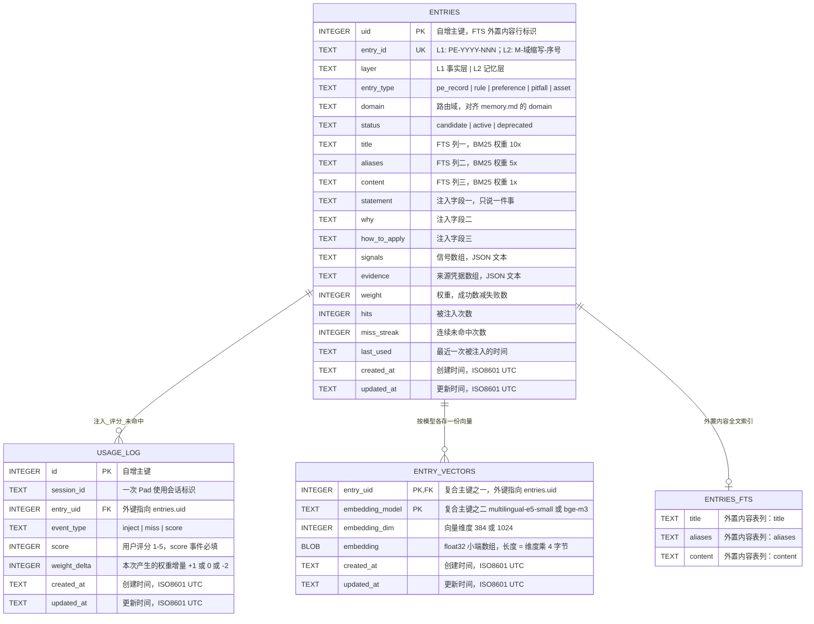

# Prompt Pad · 数据模型与数据库设计

> 依据：`AGENTS.md`（唯一事实基线）、`software_prompts/02-architecture.md` ARC-03、`docs/01-案例调研与技术选型.md`、`docs/02-私人记忆库设计.md`。
> 引擎：SQLite（单文件、零运维），启用 **FTS5**（全文）与 **sqlite-vec**（向量，阶段三才启用）。
> 嵌入：阶段一 `multilingual-e5-small`（384 维）；记录 >200 条后换 `bge-m3`（1024 维）——**换模型必须重建全库索引**，因此每条向量必须记录当时使用的模型名。
> 一致性基线：单机单写；L1 逐字不可改、只追加；L3 可随时重建，**以 Markdown 文件内容为准**；`memory/` 目录纳入 git 每日提交；权重更新与夜间批量任务不得并发写库。

---

## 1. 实体关系图



**基数与主外键说明**

| 关系 | 基数 | 语义 |
|---|---|---|
| `ENTRIES → USAGE_LOG` | 1 : N（0..多） | 一条记忆条目可被多次注入、多次评分、多次未命中；每条使用事件都必须能回溯到具体条目 |
| `ENTRIES → ENTRY_VECTORS` | 1 : N（0..多） | 同一条目在换嵌入模型后允许并存两套向量（旧向量用于判断哪些需要重嵌入，重建完成后删除） |
| `ENTRIES → ENTRIES_FTS` | 1 : 0..1 | FTS5 为**外置内容表**，行标识沿用 `entries.uid`（`content_rowid='uid'`），正文与结构化字段仍以 `entries` 为准 |
| `ENTRIES_FTS` 的主键与时间字段 | 继承 | FTS5 虚拟表本身不存储行数据，因此**无法自带主键与 `created_at` / `updated_at`**；其主键即外置内容表的 `entries.uid`，两个时间字段亦由 `entries` 提供（唯一可核对的归属表） |

> **为什么 L1 与 L2 共表**：`entries` 是 L1/L2 的**可重建索引投影**（Markdown 为准），用 `layer` 区分。L1 的 PE 记录与 L2 的记忆条目在「全文检索 + 向量化 + 使用统计」上的处理方式完全一致，共表可让 FTS 与向量索引天然覆盖两层，同时避免引入第五张业务表。DOT 位置等 UI 状态**不入库**（本地 JSON 文件持久化），故本设计只有四张表。

---

## 2. 建表 DDL

> 约束口径：每张表均有主键与 `created_at` / `updated_at`；时间统一为 ISO-8601 UTC 文本（`YYYY-MM-DDTHH:MM:SSZ`），由 `strftime(..., 'now')` 取 UTC，避免本地时区歧义。

### 2.1 `entries`（L1/L2 统一索引表）

```sql
CREATE TABLE IF NOT EXISTS entries (
    uid           INTEGER PRIMARY KEY,
    entry_id      TEXT    NOT NULL UNIQUE,
    layer         TEXT    NOT NULL CHECK (layer IN ('L1', 'L2')),
    entry_type    TEXT    NOT NULL CHECK (entry_type IN ('pe_record', 'rule', 'preference', 'pitfall', 'asset')),
    domain        TEXT    NOT NULL DEFAULT 'general',
    status        TEXT    NOT NULL DEFAULT 'active' CHECK (status IN ('candidate', 'active', 'deprecated')),
    title         TEXT    NOT NULL DEFAULT '',
    aliases       TEXT    NOT NULL DEFAULT '',
    content       TEXT    NOT NULL DEFAULT '',
    statement     TEXT,
    why           TEXT,
    how_to_apply  TEXT,
    signals       TEXT    NOT NULL DEFAULT '[]',
    evidence      TEXT    NOT NULL DEFAULT '[]',
    weight        INTEGER NOT NULL DEFAULT 0,
    hits          INTEGER NOT NULL DEFAULT 0,
    miss_streak   INTEGER NOT NULL DEFAULT 0,
    last_used     TEXT,
    created_at    TEXT    NOT NULL DEFAULT (strftime('%Y-%m-%dT%H:%M:%SZ', 'now')),
    updated_at    TEXT    NOT NULL DEFAULT (strftime('%Y-%m-%dT%H:%M:%SZ', 'now')),
    CHECK (layer <> 'L1' OR status = 'active'),
    CHECK (layer <> 'L2' OR entry_type <> 'pe_record')
);
```

- `uid`：自增主键，同时是 FTS5 外置内容的行标识（`content_rowid='uid'`），保证 FTS 行与 `entries` 行一一对应且可回表。
- `entry_id`：业务 ID。L1 为 `PE-YYYY-NNN`（永久、只追加、逐字不可改）；L2 为 `M-<域缩写>-<序号>`。唯一约束保证重复写入同一 ID 时可判定为幂等重放而非新记录。
- `layer` / `entry_type`：层与类型判别。L1 行恒为 `status='active'`（L1 不参与 `candidate → active → deprecated` 状态机）；L2 行不得使用 `pe_record` 类型。
- `title` / `aliases` / `content`：FTS5 的三列。L1 行的 `content` 为「原文 + 改写结果 + 优化策略」的合并文本；L2 行的 `content` 为 `statement` + `why` + `how_to_apply` 的合并文本，**结构化原文仍以 `statement` / `why` / `how_to_apply` 三列为准**。
- `signals` / `evidence`：JSON 数组文本（L1 的 `signals` 为事实信号，L2 的 `evidence` 回溯到 `PE-YYYY-NNN`）。**统计类字段（`weight` / `hits` / `miss_streak`）与 `evidence` 严禁注入模型上下文**，只在注入裁剪时排除。
- `weight` / `hits` / `miss_streak` / `last_used`：权重与命中统计，由 `submit_feedback` 与夜间任务维护。
- **写库互斥**：本表的 `weight` / `hits` / `miss_streak` 更新与夜间批量任务必须在同一把写锁下串行执行（应用层保证），避免与 `usage_log` 交错。

### 2.2 `entries_fts`（FTS5 外置内容虚拟表）

```sql
CREATE VIRTUAL TABLE IF NOT EXISTS entries_fts USING fts5(
    title,
    aliases,
    content,
    content='entries',
    content_rowid='uid',
    tokenize='trigram'
);
```

- **外置内容表**：`content='entries'` 表示 FTS 表不复制正文，检索命中后回表 `entries` 取值，保证索引与 Markdown 投影永远同源。
- **分词器（阶段二）**：`trigram`（SQLite FTS5 内置，无需 ICU 扩展）。按连续三字符切词；`MATCH` 对 **≥3 字** 中文子串有效（如 `的陈述`）。不足 3 字（常见双字中文词）由应用层对 `title`/`content`/`statement` 做 `LIKE` 子串回退。旧库若仍是 `unicode61`，开库时经 `PRAGMA user_version < 2` 分支 `DROP` + 重建 FTS 并 `rebuild`，再把 `user_version` 升到 `2`。
  > 行为由单测 `fts_trigram_中文子串可命中`（`src-tauri/src/storage/db.rs`）钉死。
- **列权重 10× / 5× / 1×** 是 **查询期** 生效的 BM25 参数（`bm25(entries_fts, 10.0, 5.0, 1.0)`），不是 DDL 属性，故不写进建表语句。
- **同步策略（本设计不使用触发器）**：
  - 全量重建（幂等）：`INSERT INTO entries_fts(entries_fts) VALUES('rebuild');`
  - 单行增量（幂等，与业务写入同一事务）：先 `INSERT INTO entries_fts(entries_fts, rowid, title, aliases, content) VALUES('delete', :uid, :title, :aliases, :content);` 再 `INSERT INTO entries_fts(rowid, title, aliases, content) VALUES(:uid, :title, :aliases, :content);`
  - 段合并（可选维护）：`INSERT INTO entries_fts(entries_fts) VALUES('optimize');`
- 触发器不纳入本设计：L3 索引**可随时重建**，写入路径由数据层显式控制，避免触发器在重建期间产生幽灵行。
- **关于主键与时间字段**：FTS5 虚拟表不存储行载荷，因此**无法自带主键与 `created_at` / `updated_at`**——这是 FTS5 引擎的固有属性而非设计遗漏。它的主键与两个时间字段由外置内容表 `entries` 承载（`content_rowid='uid'`），随时可经下列语句核验归属：

```sql
SELECT e.uid, e.entry_id, e.created_at, e.updated_at
FROM entries_fts f
JOIN entries e ON e.uid = f.rowid
LIMIT 10;
```

### 2.3 `entry_vectors`（按模型分存的向量表）

```sql
CREATE TABLE IF NOT EXISTS entry_vectors (
    entry_uid       INTEGER NOT NULL REFERENCES entries(uid) ON DELETE CASCADE,
    embedding_model TEXT    NOT NULL,
    embedding_dim   INTEGER NOT NULL DEFAULT 384 CHECK (embedding_dim > 0),
    embedding       BLOB    NOT NULL,
    created_at      TEXT    NOT NULL DEFAULT (strftime('%Y-%m-%dT%H:%M:%SZ', 'now')),
    updated_at      TEXT    NOT NULL DEFAULT (strftime('%Y-%m-%dT%H:%M:%SZ', 'now')),
    PRIMARY KEY (entry_uid, embedding_model)
);
```

- **复合主键 `(entry_uid, embedding_model)`**：同一条目可并存多套模型向量。换模型时写入 `embedding_model='bge-m3'` 的新行，**旧行（`multilingual-e5-small`）保留直到全库重建完成**，重建完成后再删除——这正是「必须存模型名」的目的：否则无法判断哪些向量需要重嵌入。
- `embedding_dim` 默认 **384**（阶段一 `multilingual-e5-small`），换 `bge-m3` 时写 **1024**；维度不匹配会让向量比较失去意义，故由 CHECK 保证为正数并由数据层按模型映射校验。
- `embedding`：float32 小端数组的 BLOB，长度 = `embedding_dim × 4` 字节（384 维 = 1536 字节）。**不存字符串**，避免浮点往返误差。
- **阶段一/二该表为空**：`AGENTS.md` §6.9 规定检索层未积累 20–30 条真实记录前不得引入向量库调用路径，因此 sqlite-vec 的 KNN 索引对象只在阶段三创建（见 4.3）。

### 2.4 `usage_log`（注入与评分流水）

```sql
CREATE TABLE IF NOT EXISTS usage_log (
    id           INTEGER PRIMARY KEY,
    session_id   TEXT    NOT NULL,
    entry_uid    INTEGER NOT NULL REFERENCES entries(uid) ON DELETE CASCADE,
    event_type   TEXT    NOT NULL CHECK (event_type IN ('inject', 'miss', 'score')),
    score        INTEGER CHECK (score IS NULL OR (score BETWEEN 1 AND 5)),
    weight_delta INTEGER NOT NULL DEFAULT 0,
    note         TEXT,
    created_at   TEXT    NOT NULL DEFAULT (strftime('%Y-%m-%dT%H:%M:%SZ', 'now')),
    updated_at   TEXT    NOT NULL DEFAULT (strftime('%Y-%m-%dT%H:%M:%SZ', 'now')),
    CHECK ((event_type = 'score' AND score IS NOT NULL) OR (event_type <> 'score' AND score IS NULL))
);
```

- `event_type` 三值与权重规则的对应：
  - `inject`：本会话把该条目注入进了上下文 → `entries.hits += 1`、`entries.last_used = created_at`。
  - `miss`：该条目本应被检索到但未被命中 → `hits` 不变，`entries.miss_streak += 1`（连续 3 次 → `deprecated`）。
  - `score`：用户对本次改写结果评分 1–5 → 按 `score ≥ 4 → +1`、`无改善 → 0`、`变差 → −2` 写入 `weight_delta` 并累加到 `entries.weight`。
- `note`：用户手写的复核备注，只在 `score` 事件上有值，**仅供人工回看，绝不进入模型上下文**（AGENTS.md §6.5 的同一条禁令也覆盖它）。
- **评分为条目级而非会话级**：一次评分会影响该会话中**所有被注入的条目**，因此数据层在该会话的每个被注入条目上各写一条 `score` 行（`score` 值相同、`weight_delta` 相同）。这样外键完整、权重更新可逐条审计，无需额外的会话评分表。
- `session_id` 是一次 Pad 使用会话（一次唤起 → 输入 → 改写 → 反馈）的标识，用于把注入、评分、未命中三类事件串成一条可回溯的链。
- **`miss` 事件的 `session_id` 用夜间运行日期**（`YYYY-MM-DD`）而不是 PE 记录 ID：未命中是在夜间沉淀时按「该条目所属的域当天有记录、但它的 signals 没被触发」判定的，属于一次夜间扫描的结论。用日期做 session_id 可以把同一次扫描的 miss 事件归到一起，直接数出「连续 3 次」。
- **`score` 事件的会话锚点行**：一次反馈若没有注入任何记忆，就没有任何条目可挂 score 行，冷启动豁免的计数会永远不前进。此时补一条挂在 PE 记录（L1 行）上的 score 行，`weight_delta = 0`，只用于标记「这次使用发生过反馈」，不参与任何权重计算（PE 记录没有权重语义）。
- **索引层与 Markdown 的双向对齐**：夜间任务写回 `memory.md` 后，除 upsert 命中条目外，还要删除索引里不在 `memory.md` 中的 L2 行（`delete_memories_not_in`），再重建 FTS。只有写入方向对齐的话，用户手删条目后索引会长期残留，「以 Markdown 为准」就成了空话。

---

## 3. 索引设计表

> 每条索引必须绑定输入中的查询场景；绑定不上的索引一律不设计。

| 索引名 | 目标表 | 键列（顺序） | 绑定的查询场景 | 命中原理 |
|---|---|---|---|---|
| `idx_entries_route` | `entries` | `(layer, domain, status, weight DESC)` | ①按 domain 路由取 `status=active` 且 `weight>0` 的条目，按 weight 降序取 Top-K（阶段一 <50 条；阶段三同样适用） | 三个等值列（`layer`/`domain`/`status`）在前，`weight` 作为范围过滤 + 排序列在最后；索引本身按 `weight DESC` 有序，SQLite 沿索引序扫描到满足 `weight>0` 的前 K 行即可停止，**无需回表排序** |
| `idx_entries_layer_created` | `entries` | `(layer, created_at)` | ④夜间任务扫描当天新增的 PE 记录 | `layer` 等值在前、`created_at` 范围在后，可直接定位到当天的时间区间，扫描范围 = 当天记录数 |
| `idx_entries_promotion` | `entries` | `(weight DESC)`，部分索引 `WHERE layer='L2' AND status='candidate'` | ④夜间任务的晋升检查（状态机 `candidate --(weight ≥2 且无失败)--> active`） | 部分索引只收录待晋升候选，体积与条目总数无关；晋升判定是「`weight ≥ 2`」这一**范围条件**，索引键 `weight DESC` 可直接定位（执行计划形如 `SEARCH entries USING COVERING INDEX idx_entries_promotion (weight>?)`）。**注意**：若改写成「按 weight 排序列出全部候选」，规划器会转用 `idx_entries_route` 并加一次临时排序——故夜间任务应使用阈值型查询而非排序型查询 |
| `idx_usage_log_entry_event` | `usage_log` | `(entry_uid, event_type, created_at)` | ⑤权重更新与**连续未命中计数** | `entry_uid` 等值 + `event_type` 等值在前、`created_at` 范围在后，可直接数出「上次注入之后」的 `miss` 事件条数，判定是否达到连续 3 次 |
| `idx_usage_log_session` | `usage_log` | `(session_id, created_at)` | ⑤把一次会话的注入 / 评分 / 未命中事件串成链（反馈落库时回溯本会话的注入集） | `session_id` 等值在前、`created_at` 范围在后；按时间序读出该会话的事件序列 |
| `idx_entry_vectors_model` | `entry_vectors` | `(embedding_model)` | ③换模型时筛出**需要重嵌入的向量**，以及按当前模型重建 KNN 索引 | 等值列，可一次取出某模型的全部向量行；`embedding_model` 为复合主键第二列，本索引服务于「按模型批量筛选」而非按条目点查 |

**隐式索引（由约束自动创建）**

| 索引 | 来源 | 绑定的查询场景 | 命中原理 |
|---|---|---|---|
| `sqlite_autoindex_entries_entry_id` | `entries.entry_id` 的 `UNIQUE` | 按 `PE-YYYY-NNN` / `M-<域缩写>-<序号>` 精确回溯（`evidence` 溯源、记录写入幂等判定） | B-tree 唯一索引，等值点查，O(log n) |

**明确不设计的索引及原因**

| 候选索引 | 不设计的原因 |
|---|---|
| `entries(content)` 普通 B-tree | 全文检索由 FTS5 倒排索引承担；对正文建 B-tree 既无法加速 `MATCH`，还会给每条记忆带来一份重复存储 |
| `entries(signals)` / `entries(evidence)` | 二者是 JSON 文本，业务上只做**整字段读取**（夜间任务解析后去重合并），从无「按某个 signal 值过滤」的查询场景，绑定不上即不设计 |
| `entries(status)` / `entries(weight)` 独立单列索引 | `status` 与 `weight` 总是与 `layer`、`domain` 或 `entry_uid` 组合出现，单列索引会被组合查询直接跳过，只增加写放大 |
| `usage_log(created_at)` 单列 | 所有时间范围查询都先按 `entry_uid` 或 `session_id` 收窄，单列时间索引不会被选中 |
| `usage_log(score)` | 评分只按条目读取，不存在「按分数查评分」的查询场景 |
| `entry_vectors(embedding_dim)` | 维度由 `embedding_model` 唯一决定，查维度必先查模型名，`idx_entry_vectors_model` 已足够 |
| FTS5 表上手工建 B-tree | FTS5 自带倒排索引，`MATCH` 不走 B-tree，手工索引无效 |
| `entries_fts` 上的额外列 | FTS5 虚拟表不接受普通列定义，结构化字段（`statement` 等）已在 `entries` 中 |

---

## 4. 迁移脚本

> 迁移规约：① **只向前追加**，不改写已发布的迁移；② 全部语句**幂等**（`CREATE TABLE IF NOT EXISTS` / `CREATE VIRTUAL TABLE IF NOT EXISTS` / `CREATE INDEX IF NOT EXISTS` / `DROP ... IF EXISTS`），重复执行结果一致；③ `PRAGMA foreign_keys = ON` 是**连接级**设置且在事务内为 no-op，数据层必须在**每次打开连接时、事务之外**设置；④ 迁移执行在写锁内，与实时权重更新互斥。

### 4.1 `001_l3_baseline.up.sql`（正向：L3 索引库基线，阶段一/二）

```sql
-- Prompt Pad · L3 索引库基线迁移
-- 幂等：可重复执行；只向前追加，不修改已发布迁移
PRAGMA foreign_keys = ON;          -- 连接级设置，必须在事务外、每次连接打开时执行

BEGIN;

CREATE TABLE IF NOT EXISTS entries (
    uid           INTEGER PRIMARY KEY,
    entry_id      TEXT    NOT NULL UNIQUE,
    layer         TEXT    NOT NULL CHECK (layer IN ('L1', 'L2')),
    entry_type    TEXT    NOT NULL CHECK (entry_type IN ('pe_record', 'rule', 'preference', 'pitfall', 'asset')),
    domain        TEXT    NOT NULL DEFAULT 'general',
    status        TEXT    NOT NULL DEFAULT 'active' CHECK (status IN ('candidate', 'active', 'deprecated')),
    title         TEXT    NOT NULL DEFAULT '',
    aliases       TEXT    NOT NULL DEFAULT '',
    content       TEXT    NOT NULL DEFAULT '',
    statement     TEXT,
    why           TEXT,
    how_to_apply  TEXT,
    signals       TEXT    NOT NULL DEFAULT '[]',
    evidence      TEXT    NOT NULL DEFAULT '[]',
    weight        INTEGER NOT NULL DEFAULT 0,
    hits          INTEGER NOT NULL DEFAULT 0,
    miss_streak   INTEGER NOT NULL DEFAULT 0,
    last_used     TEXT,
    created_at    TEXT    NOT NULL DEFAULT (strftime('%Y-%m-%dT%H:%M:%SZ', 'now')),
    updated_at    TEXT    NOT NULL DEFAULT (strftime('%Y-%m-%dT%H:%M:%SZ', 'now')),
    CHECK (layer <> 'L1' OR status = 'active'),
    CHECK (layer <> 'L2' OR entry_type <> 'pe_record')
);

CREATE VIRTUAL TABLE IF NOT EXISTS entries_fts USING fts5(
    title,
    aliases,
    content,
    content='entries',
    content_rowid='uid',
    tokenize='trigram'
);

CREATE TABLE IF NOT EXISTS entry_vectors (
    entry_uid       INTEGER NOT NULL REFERENCES entries(uid) ON DELETE CASCADE,
    embedding_model TEXT    NOT NULL,
    embedding_dim   INTEGER NOT NULL DEFAULT 384 CHECK (embedding_dim > 0),
    embedding       BLOB    NOT NULL,
    created_at      TEXT    NOT NULL DEFAULT (strftime('%Y-%m-%dT%H:%M:%SZ', 'now')),
    updated_at      TEXT    NOT NULL DEFAULT (strftime('%Y-%m-%dT%H:%M:%SZ', 'now')),
    PRIMARY KEY (entry_uid, embedding_model)
);

CREATE TABLE IF NOT EXISTS usage_log (
    id           INTEGER PRIMARY KEY,
    session_id   TEXT    NOT NULL,
    entry_uid    INTEGER NOT NULL REFERENCES entries(uid) ON DELETE CASCADE,
    event_type   TEXT    NOT NULL CHECK (event_type IN ('inject', 'miss', 'score')),
    score        INTEGER CHECK (score IS NULL OR (score BETWEEN 1 AND 5)),
    weight_delta INTEGER NOT NULL DEFAULT 0,
    note         TEXT,
    created_at   TEXT    NOT NULL DEFAULT (strftime('%Y-%m-%dT%H:%M:%SZ', 'now')),
    updated_at   TEXT    NOT NULL DEFAULT (strftime('%Y-%m-%dT%H:%M:%SZ', 'now')),
    CHECK ((event_type = 'score' AND score IS NOT NULL) OR (event_type <> 'score' AND score IS NULL))
);

CREATE INDEX IF NOT EXISTS idx_entries_route       ON entries(layer, domain, status, weight DESC);
CREATE INDEX IF NOT EXISTS idx_entries_layer_created ON entries(layer, created_at);
CREATE INDEX IF NOT EXISTS idx_entries_promotion   ON entries(weight DESC) WHERE layer = 'L2' AND status = 'candidate';
CREATE INDEX IF NOT EXISTS idx_usage_log_entry_event ON usage_log(entry_uid, event_type, created_at);
CREATE INDEX IF NOT EXISTS idx_usage_log_session   ON usage_log(session_id, created_at);
CREATE INDEX IF NOT EXISTS idx_entry_vectors_model ON entry_vectors(embedding_model);

COMMIT;
```

### 4.2 `001_l3_baseline.down.sql`（回滚）

```sql
-- Prompt Pad · L3 索引库基线回滚
-- 幂等：重复执行不报错；先删外键依赖方，再删被引用方
PRAGMA foreign_keys = ON;

BEGIN;

DROP INDEX IF EXISTS idx_entries_route;
DROP INDEX IF EXISTS idx_entries_layer_created;
DROP INDEX IF EXISTS idx_entries_promotion;
DROP INDEX IF EXISTS idx_usage_log_entry_event;
DROP INDEX IF EXISTS idx_usage_log_session;
DROP INDEX IF EXISTS idx_entry_vectors_model;

DROP TABLE IF EXISTS usage_log;
DROP TABLE IF EXISTS entry_vectors;
DROP TABLE IF EXISTS entries_fts;   -- 外置内容表：必须先于 entries 删除
DROP TABLE IF EXISTS entries;

COMMIT;
```

> 回滚代价提示：L3 全部内容可由 `memory/` 的 Markdown 重建（AGENTS.md §4.9），因此该回滚**不丢事实**，只丢索引与使用流水（流水统计可从 `memory/` 与 git 历史重建到有限精度）。

### 4.3 `002_stage3_vec.up.sql`（正向：阶段三 sqlite-vec KNN 索引对象）

> **执行门禁**：`AGENTS.md` §6.9 规定检索层未积累 20–30 条真实记录前不得引入向量库调用路径。本迁移**仅在 PE 记录总数 >200（切换 `bge-m3` / 启用阶段三）时执行**，且必须在写锁内、暂停夜间任务与实时反馈后执行。
> **维度参数**：`float[384]` 是阶段一 `multilingual-e5-small` 的维度；切换 `bge-m3` 时必须把占位符替换为 `float[1024]` 并**重建**（sqlite-vec 虚拟表的向量维度在建表时固定，不能原地改列）。

```sql
PRAGMA foreign_keys = ON;

BEGIN;

-- 派生索引对象：可随时删除重建，数据真源是 entry_vectors
DROP TABLE IF EXISTS entry_vectors_knn;

CREATE VIRTUAL TABLE IF NOT EXISTS entry_vectors_knn USING vec0(
    entry_uid INTEGER PRIMARY KEY,
    embedding float[384]
);

COMMIT;
```

重建回填（幂等，按当前模型筛选源向量）：

```sql
INSERT INTO entry_vectors_knn(entry_uid, embedding)
SELECT entry_uid, embedding
FROM entry_vectors
WHERE embedding_model = :active_embedding_model;
```

### 4.4 `002_stage3_vec.down.sql`（回滚）

```sql
PRAGMA foreign_keys = ON;

BEGIN;
DROP TABLE IF EXISTS entry_vectors_knn;
COMMIT;
```

> 回滚只删除派生 KNN 索引，`entry_vectors` 中的向量与模型名保留，可随时重建。`001` 与 `002` 的执行顺序不可颠倒（`002` 依赖 `001` 已建好的 `entries` / `entry_vectors`）。

### 4.5 迁移后自检（幂等、可重复执行）

```sql
-- 1) 四张表存在
SELECT name FROM sqlite_master WHERE type IN ('table','view') AND name IN ('entries','entries_fts','entry_vectors','usage_log');
-- 2) 索引齐备
SELECT name FROM sqlite_master WHERE type='index' AND name LIKE 'idx_%';
-- 3) 外键完整性
PRAGMA foreign_key_check;
-- 4) 全文索引与内容表一致（应返回 0 行差异）
INSERT INTO entries_fts(entries_fts) VALUES('rebuild');   -- 幂等重建
```

---

## 5. 查询索引命中分析

> 以下「预期扫描量级」是**依据输入给定的数据量级推导**（记忆条目 <50 / 50–300 / 300+ 条，PE 记录日增数条）的量级估计，**不是实测指标**；本设计不编造性能数字。
> 本节给出的执行计划形态取自对本文件 DDL 的 `EXPLAIN QUERY PLAN` 结构（SQLite 3.51.2，内存库），用于佐证「命中哪个索引」的判断；它是**索引选择结构**而非性能指标。

### 查询 1 · 注入集 domain 路由 Top-K（场景①，最常见：每次改写都会走）

```sql
SELECT uid, entry_id, statement, why, how_to_apply
FROM entries
WHERE layer = 'L2'
  AND domain = :domain
  AND status = 'active'
  AND weight > 0
ORDER BY weight DESC
LIMIT :k;
```

- **命中索引**：`idx_entries_route (layer, domain, status, weight DESC)`。
- **命中原理**：三个等值列全部在索引前导位置，命中一个唯一索引区间；`weight` 位于末位且索引按 `weight DESC` 物理有序，`ORDER BY weight DESC` 被索引序直接满足，**不产生临时排序**；`weight > 0` 在有序区间上向前扫描到首个非正值即停。执行计划形如 `SEARCH entries USING COVERING INDEX idx_entries_route (layer=? AND domain=? AND status=? AND weight>?)`——**覆盖索引**，取 `statement` / `why` / `how_to_apply` 时才回表。
- **预期扫描量级**：阶段一（<50 条 L2 条目）→ 扫描索引项 **<50**，取回 **≤10** 行；阶段三（300+ 条）→ 扫描仍止于满足 `weight>0` 的前 K 个位置，**十量级～数十量级**个索引项；回表读 `statement`/`why`/`how_to_apply` 为 **≤10 次随机 I/O**。索引页读取 **1–2 页**。

### 查询 2 · FTS5 BM25 全文检索（场景②，阶段二/三）

```sql
SELECT e.uid, e.entry_id, e.statement, e.why, e.how_to_apply,
       bm25(entries_fts, 10.0, 5.0, 1.0) AS score
FROM entries_fts
JOIN entries e ON e.uid = entries_fts.rowid
WHERE entries_fts MATCH :query
ORDER BY score
LIMIT :k;
```

- **命中索引**：`entries_fts` 的 **FTS5 倒排索引**（非 B-tree 索引，本设计未给它建任何手工索引）；列权重 `title 10× / aliases 5× / content 1×` 由查询期 `bm25()` 参数提供。
- **命中原理**：`MATCH` 先在倒排链上定位候选行（并集/交集由 FTS5 语法决定），`bm25()` 对候选集打分后按分排序；`content='entries'` 使正文从 `entries` 回表读取，索引与 Markdown 投影同源。执行计划形如 `SCAN entries_fts VIRTUAL TABLE INDEX 0:M3` + `SEARCH e USING INTEGER PRIMARY KEY (rowid=?)`；候选集上的 `ORDER BY score` 由一次**临时 B 树排序**完成（排序对象是候选集，不是全库）。
- **预期扫描量级**：候选集大小 = 命中词的倒排链长度 P，扫描 **≈ P 行**；50–300 条规模下 P 通常为**十量级到百量级**；随后对前 K 行回表 **≤10 次**。若查询词在库中不存在，倒排链为空，扫描 **0 行**并直接返回「暂无历史经验」。
- **分词器**：`trigram`（见 §2.2）。查询串须经 `sanitize_fts_query` 去掉 FTS5 运算符；清洗后为空则本查询不执行，由应用层回退阶段一 domain 路由。

### 查询 3 · 向量 KNN + RRF 归一化（场景③，阶段三）

```sql
-- 3a 当前模型下的向量集合（换模型重建时使用）
SELECT entry_uid, embedding FROM entry_vectors WHERE embedding_model = :active_embedding_model;

-- 3b KNN 召回（阶段三 KNN 索引对象）
SELECT entry_uid, distance FROM entry_vectors_knn
WHERE embedding MATCH :query_vector AND k = :k;

-- 3c 把 KNN 命中映射回条目并参与 RRF 融合
SELECT e.uid, e.entry_id, e.statement, e.why, e.how_to_apply
FROM entries e
WHERE e.uid IN (:knn_hit_uids)
  AND e.layer = 'L2' AND e.status = 'active' AND e.weight > 0;
```

- **命中索引**：3a 命中 `idx_entry_vectors_model`（`embedding_model` 等值，取出该模型的全部向量行用于重建）；3b 命中 `entry_vectors_knn` 的 sqlite-vec 向量索引（HNSW 近似最近邻，**不走 B-tree**）；3c 命中 `idx_entries_route` 的 `layer`/`status` 前导列（`uid` 为点查主键），过滤出可注入的条目。
- **命中原理**：KNN 返回 `k` 个最近邻 `entry_uid`；RRF 按 `1/(60+rank)` 累加 BM25 与 KNN 两路排名后归一化到 0–1，再交由应用层按 `weight` 降序裁剪到 ≤800 token。
- **预期扫描量级**：向量索引按近似最近邻访问，扫描 **≈ k 个候选向量**（k 通常取个位到十位）；3c 的条目回表 **≤10 行**；RRF 融合在内存中对 **两路各 ≤K 条**排序，无磁盘扫描。

### 查询 4 · 权重更新与连续未命中计数（场景⑤，每次反馈都走）

```sql
-- 4a 读出该条目自上次注入以来的连续未命中次数
SELECT COUNT(*) AS miss_count
FROM usage_log
WHERE entry_uid = :entry_uid
  AND event_type = 'miss'
  AND created_at > :last_inject_at;

-- 4b 按会话回溯本会话的注入集（写入 score 行时使用）
SELECT entry_uid, event_type, score
FROM usage_log
WHERE session_id = :session_id
ORDER BY created_at;
```

- **命中索引**：4a 命中 `idx_usage_log_entry_event (entry_uid, event_type, created_at)`——`entry_uid` 与 `event_type` 两个等值列在前、`created_at` 范围在后，直接在时间有序区间内计数；4b 命中 `idx_usage_log_session (session_id, created_at)`，`session_id` 等值在前、`created_at` 范围在后，按时间序读出事件序列。
- **命中原理**：等值列定位到唯一索引区间后，范围列收敛到「上次注入之后」的窄区间，计数与排序都无需排序步骤。执行计划形如 `SEARCH usage_log USING COVERING INDEX idx_usage_log_entry_event (entry_uid=? AND event_type=? AND created_at>?)` 与 `SEARCH usage_log USING INDEX idx_usage_log_session (session_id=?)`（后者由索引序直接满足 `ORDER BY created_at`，无临时排序）。
- **预期扫描量级**：4a 扫描 = 该条目自上次注入后的 `miss` 事件数（**个位到十位**）；4b 扫描 = 该会话的事件数 = 被注入条目数 + 未命中条目数 + 同数目的评分行（**十量级以内**）。命中 `≥3` 次连续未命中 → `entries.status` 置 `deprecated`；`weight ≥2` 且无失败 → 由 `candidate` 升 `active`。

### 查询 5 · 夜间任务扫描当天新增 PE 记录（场景④）

```sql
SELECT uid, entry_id, domain, title, content, signals, created_at
FROM entries
WHERE layer = 'L1'
  AND created_at >= :day_start
  AND created_at <  :day_end
ORDER BY created_at;
```

- **命中索引**：`idx_entries_layer_created (layer, created_at)`。
- **命中原理**：`layer` 等值列在前、`created_at` 范围在后，直接定位到当天的连续区间；`ORDER BY created_at` 由索引序满足，无临时排序。执行计划形如 `SEARCH entries USING INDEX idx_entries_layer_created (layer=? AND created_at>? AND created_at<?)`。
- **配套的晋升检查**：同一次夜间任务还要判定状态机晋升，用**阈值型**查询 `WHERE layer='L2' AND status='candidate' AND weight>=2`，命中 `idx_entries_promotion`（`SEARCH entries USING COVERING INDEX idx_entries_promotion (weight>?)`）；若改写为按 weight 排序取候选，规划器会改用 `idx_entries_route` 并追加一次临时排序。
- **预期扫描量级**：扫描 = **当天新增 PE 记录数**（输入给的是「日增数条」→ **十量级以内**），回表行数相同。随后对该批记录做 signals 去重合并、与 L2 条目做相似度匹配，匹配上则 `weight +1` 并补 `evidence`，无匹配且达标则新建 `candidate`，矛盾则**挂起人工裁决不自动写入**。

---

## 6. 与其它层的接口约定（一致性要点）

| 约束 | 落地位置 | 说明 |
|---|---|---|
| 单写 + 互斥 | 应用层写锁 | 权重更新与夜间批任务不得并发写库；两者在同一写锁下排队 |
| L1 逐字不可改、只追加 | 数据层 `storage/markdown.rs` | `entries` 中 L1 行的 `content` 只写入不更新；`entry_id` 唯一约束保证同一 PE 记录重复写入被识别为幂等重放 |
| L3 可重建、以 Markdown 为准 | 数据层 `storage/db.rs` | 提供「清空 → 从 `memory/*.md` 全量重建」路径，重建期间 FTS 与向量索引一并重建（幂等） |
| 统计字段禁止注入 | 应用层裁剪 | `weight` / `hits` / `miss_streak` / `evidence` 只在库内与 UI 使用，注入集只取 `statement` + `why` + `how_to_apply` |
| 候选不注入 | 应用层过滤 | `status='candidate'` 不进注入集；`deprecated` 不注入且不占 token 预算 |
| 800 token 硬上限 | 应用层裁剪 | 超预算时按 `weight` 从低到高裁剪；超限且无法裁剪时**拒绝晋升**并报错 |
| UI 状态不入库 | 数据层 `storage/state.rs` | DOT 位置等状态存本地 JSON 文件，避免污染记忆库与 git 提交噪声 |
